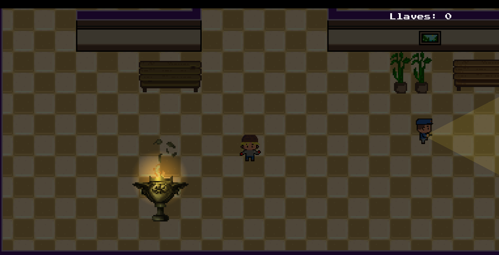
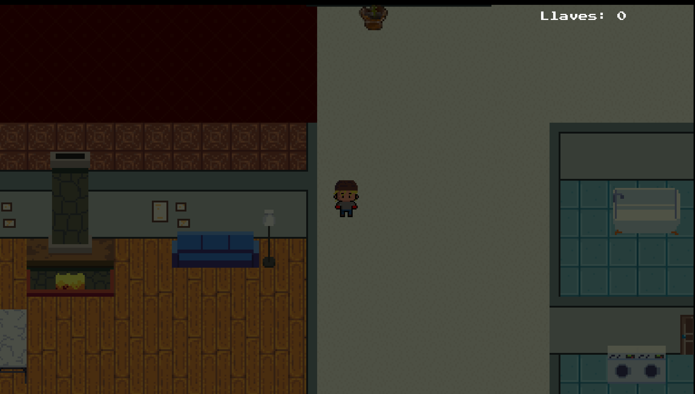
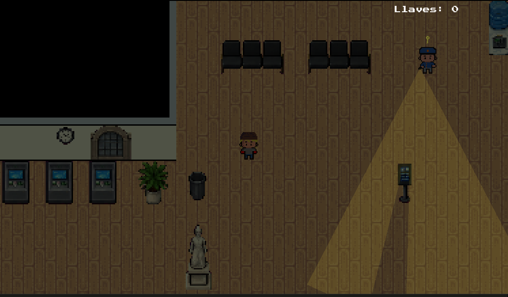

# 🕵️ The Hidden Thief

**The Hidden Thief** is a 2D top-down stealth game developed with **Godot 4.6.1** as a final project for the Video Game Programming III course at the Universidad Nacional del Litoral (UNL), Argentina.

Take advantage of the darkness to infiltrate guarded locations, avoid security guards, collect keys, unlock doors, and steal valuable treasures.

But be careful! Once you steal the treasure, the alarm is triggered, and you must escape before the police arrive.

## 🎮 Play the Game

### 🌐 Play Online
Play directly in your browser on itch.io:

[Play The Hidden Thief on itch.io](https://lucasbff85.itch.io/the-hidden-thief)

### 💻 Download for Windows
Download the latest Windows version from GitHub Releases:

[Download The Hidden Thief](https://github.com/bfflucas/The-Hidden-Thief/releases)

## ✨ Features

- Three levels: Museum, Mansion, and Bank.
- Guards with AI, patrol routes, vision, hearing, investigation, and pursuit.
- Three movement modes: walking, running, and sneaking.
- Interactive keys, doors, and treasures.
- Three difficulty settings: Easy, Normal, and Hard.
- Save and load system using JSON.
- Interactive tutorial.
- Pixel art graphics and 8-directional character animations.
- Alarm and timed escape mechanics.

## 📸 Screenshots

### Museum


### Mansion


### Bank


## ⌨️ Controls

| Key | Action |
|---|---|
| WASD / Arrow Keys | Move |
| E | Interact / Steal |
| Space | Sneak |
| Shift | Run |
| P | Pause |

## 🛠️ Technologies

- **Engine:** Godot 4.6.1
- **Language:** GDScript
- **Graphics:** 2D Pixel Art
- **Version Control:** Git & GitHub
- **Platforms:** Windows and Web

## 📂 Project Structure

```text
The-Hidden-Thief/
├── Documentos/          # Technical documentation
├── tp-final-pv-3/        # Godot project
├── screenshots/          # Gameplay screenshots
└── README.md
```

## 🚀 Running the Project

1. Clone or download this repository.
2. Open Godot 4.6.1.
3. Import the `project.godot` file located inside `tp-final-pv-3`.
4. Run the project from the Godot editor.

Alternatively, download the Windows release or play online through itch.io.

## 📚 Academic Project

Developed as a final project for **Programación de Videojuegos III**, part of the **Tecnicatura en Diseño y Programación de Videojuegos** at the **Universidad Nacional del Litoral (UNL)**, Argentina.

**Developer:** Lucas Boffa

**Version:** 1.0.0

---

*Steal the treasures, escape the guards, and become a legendary thief!*
